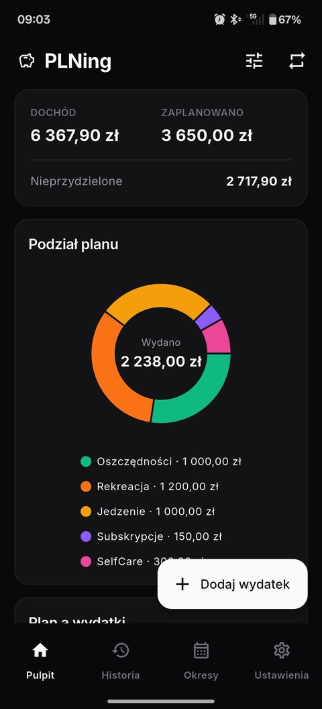
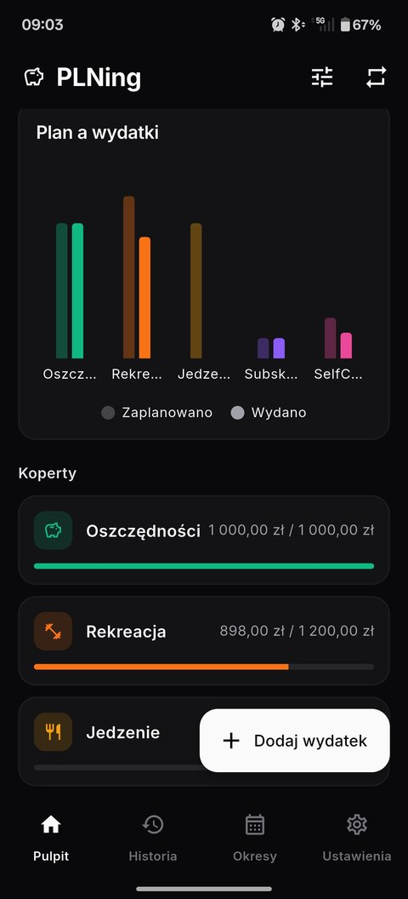
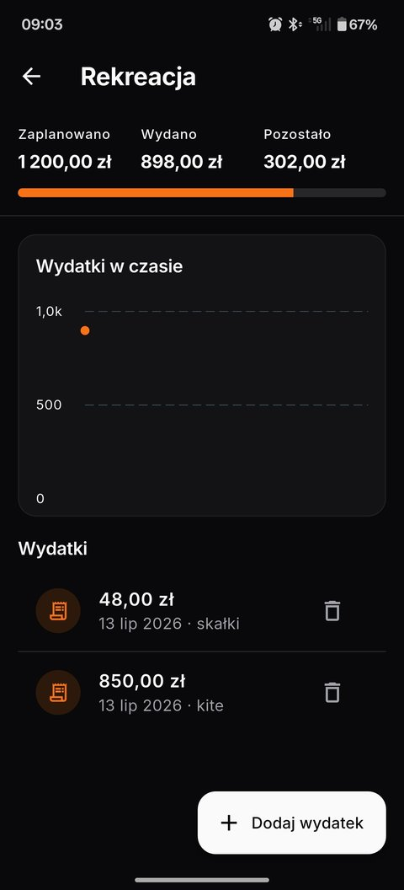
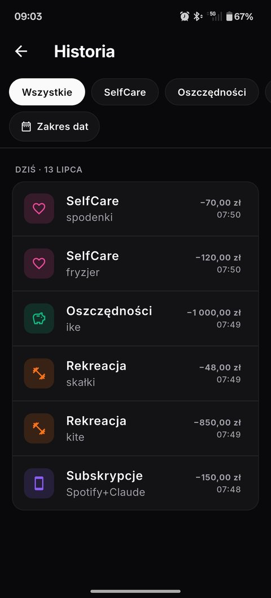

<div align="center">

# 💰 Money Planner

**An envelope-budgeting app that helps you _plan_ your money — not just track it.**

Plan your income across categories at the start of each period, then watch
*planned vs. spent vs. remaining* update as you log real spending.

[](https://flutter.dev)
[](https://dart.dev)
[](#)
[](LICENSE)

</div>

---

## ✨ The idea

Most finance apps are *trackers* — they tell you where your money went after it's
gone. Money Planner is a **planner**. It's built around **envelope budgeting**:

1. **Enter your income** for a period (e.g. July 2026).
2. **Split** that income across categories — Rent, Food, Savings, Fun… Each
   category is a virtual *envelope* you fill up front.
3. As the period goes on, **log spending** against each envelope.
4. See, per category and overall: **planned vs. spent vs. remaining** — with charts.

Delete a category mid-period? Its unspent allocation flows back into an
**Unallocated** pool, ready to re-split — while its past expenses stay on record
so your history is never distorted.

## 📱 Screenshots

<div align="center">
<table>
<tr>
<td align="center" width="25%">
<br>
Dashboard
</td>
<td align="center" width="25%">
<br>
Plan vs. spent
</td>
<td align="center" width="25%">
<br>
Category detail
</td>
<td align="center" width="25%">
<br>
History
</td>
</tr>
</table>
</div>

## 🎯 Features

| | |
|---|---|
| 🧧 **Envelope budgeting** | Allocate income to categories; spend against the plan |
| 📊 **Visual insight** | Pie chart of your split, progress bars for spent-vs-planned, spending-over-time line charts |
| 🔁 **Recurring rules** | Templates for regular expenses (rent, subscriptions) that pre-fill new periods and add themselves with one tap |
| 🧮 **Unallocated tracking** | Always know how much income is still free to assign |
| 📌 **Persistent balance bar** | Remaining balance stays visible on every screen |
| 🧭 **Bottom navigation** | Pulpit (dashboard) · Historia · Okresy · Ustawienia, one tap away |
| 🕓 **History** | Read-only summaries and charts for past periods |
| 🔐 **Local security** | PIN + biometric unlock (`local_auth`) |
| ☁️ **Server-backed** | Your data lives on the Money Planner API, so it survives a lost phone and is the base for sharing a budget |

## 🏗️ Architecture

The app is a client of the Money Planner API (`apps/api` in the monorepo). It
needs the server: there is no local copy of the data, and a failed request
shows why and offers to try again.

```
lib/
├── main.dart                 # Entry point
├── app.dart                  # MaterialApp: providers, theming, routing
├── models/                   # What the UI works with (pure Dart)
│   ├── period.dart, category.dart, expense.dart, recurring_rule.dart
│   ├── envelope.dart         # the plan: income → category allocation
│   ├── category_progress.dart, period_summary.dart, transaction.dart
├── data/                     # Everything that talks to the backend
│   ├── planner_repository.dart  # the one entry point, in the app's terms
│   ├── mappers.dart          # API types <-> models
│   ├── money.dart            # minor units (grosze) <-> whole units
│   ├── api_client.dart       # Dio setup, API_URL
│   ├── api_exception.dart    # failures the UI can react to
│   └── legacy_migrator.dart  # one-off: old local database -> server
├── state/
│   ├── planner_state.dart    # current period, progress, totals (Provider)
│   └── app_settings.dart     # theme, first day of month (on the device)
├── widgets/                  # shared widgets (error view, remote data, …)
└── screens/                  # dashboard, history, periods, settings, …
```

**Layers.** Screens only talk to `PlannerState`; the state talks to
`PlannerRepository`, the only place that knows about HTTP. The repository uses
the generated client in `packages/api-client-dart`, so requests and responses
are typed and cannot drift from the API. Models use whole units (zł) and
`DateTime`; the API uses minor units and ISO strings, and `data/mappers.dart`
is where they meet.

**Money.** Amounts are integers in the minor unit of the period's currency
(12.34 PLN is 1234; JPY has none). Periods carry a currency, PLN by default;
choosing another one is not in the UI yet, but nothing assumes złoty except
how amounts are printed.

**Failures.** Repository methods throw `ApiException` (unreachable, not found,
conflict, invalid, server). Screens run changes through `attempt(...)`, which
shows a message and lets the user retry, and show fetched data through
`RemoteData`, which has a spinner, an error view with a retry button, and the
data.

**Moving old data.** The first version kept everything in a local SQLite
database. On launch, `LegacyMigrator` uploads that database once (to
`POST /import/legacy`) when the server is still empty, then renames the file
to `money_planner.db.migrated`. It never overwrites data the server already
has, and keeps the file if anything goes wrong so the next launch can retry.

## 🔒 Security model

- **Unlock** — biometric via `local_auth`, with a PIN fallback stored as a
  **salted hash** (never plaintext). This only guards the app on the device;
  there are no accounts yet, so the server does not authenticate requests.
- The PIN hash and a few preferences live in `flutter_secure_storage`.

## 🛠️ Tech stack

| Concern | Package |
|---|---|
| Backend client | `bida_api_client` (generated from the API contract), `dio` |
| Charts | `fl_chart` |
| State management | `provider` |
| Secure storage | `flutter_secure_storage` |
| Biometric / PIN | `local_auth`, `crypto` |
| Date & currency formatting | `intl` |
| Reading the old local database | `sqflite` (+ `sqflite_common_ffi` for desktop) |

## 🚀 Getting started

From the repository root, `devenv shell` and `devenv up` start Postgres, the
API and the docs; `devenv up` also starts an emulator and runs the app on it.
To run the app by hand:

```bash
cd apps/mobile
flutter pub get
flutter run --dart-define=API_URL=http://10.0.2.2:3000   # Android emulator
```

`10.0.2.2` is the host machine as seen from the Android emulator (the default).
Use the machine's address on a real device. Debug builds allow plain HTTP.

Run the checks:

```bash
flutter analyze
flutter test
```

> **Windows note:** running the app on the Windows desktop target requires
> [Developer Mode](https://learn.microsoft.com/windows/apps/get-started/enable-your-device-for-development)
> enabled (for plugin symlink support). Android/iOS builds need Android
> Studio / Xcode set up respectively.

## 🗺️ Roadmap

- [x] **Phase 0** — Project scaffold, data model, SQLite schema
- [x] **Phase 1** — New Period & Add Expense screens, numeric dashboard, category detail with expense history
- [x] **Phase 2** — Charts (pie split, planned-vs-spent bars, spending-over-time line)
- [x] **Phase 3** — Recurring rules: templates, pre-fill new periods, auto-generate expenses
- [x] **Phase 4** — PIN (salted PBKDF2) + biometric lock screen, Settings security section
- [x] **Phase 5** — Encrypted GitHub sync (replaced by the API: data now lives on the server)
- [x] **Phase 6** — Read-only History view (past periods + charts), bottom navigation bar, edge-case polish

🎉 **All planned phases are complete.**

**Extras already in:** custom categories with icon/color picker · full Polish localization (`pl`) with zł currency · period switcher · bottom navigation bar.

## 🤝 Contributing

This is a personal/portfolio project, but issues and suggestions are welcome —
open an issue to start a conversation.

## 📄 License

Released under the [MIT License](LICENSE).
