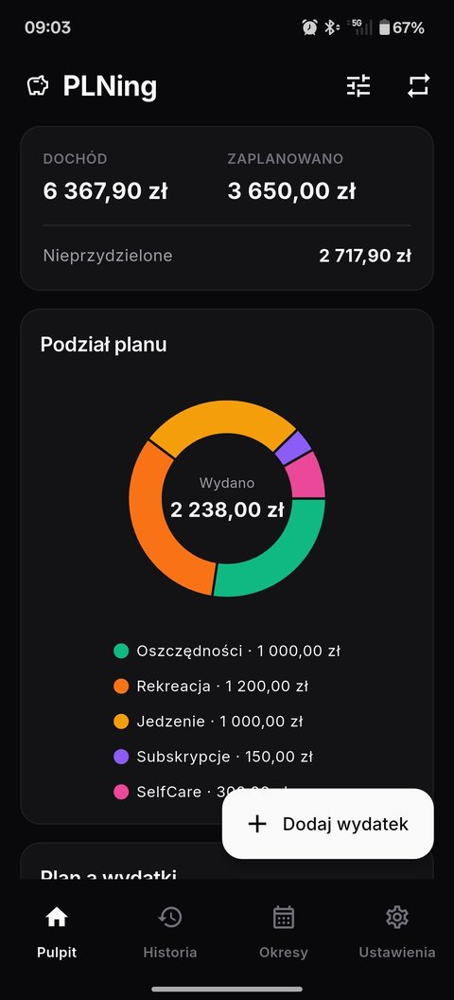
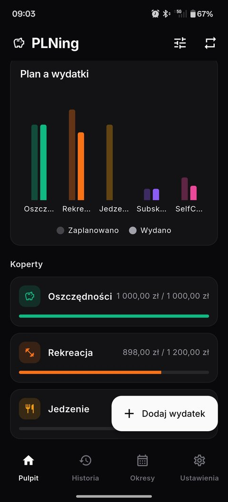
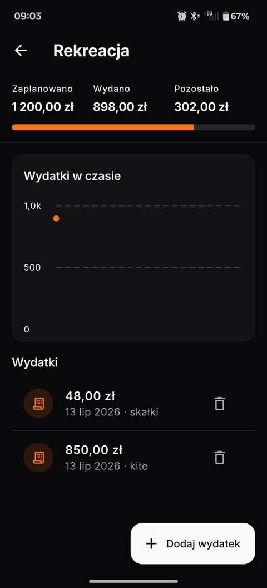
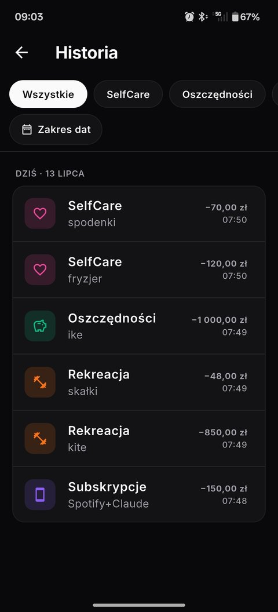

<div align="center">

# 💰 Money Planner

**A household budgeting app that helps you _plan_ your money — not just track it.**

Put your income into a private wallet, hand money out to your households, and
plan every period of a household envelope by envelope. Whatever is left when a
period ends goes on to the next one.

[](https://flutter.dev)
[](https://dart.dev)
[](#)
[](LICENSE)

</div>

---

## ✨ The idea

Most finance apps are *trackers* — they tell you where your money went after it's
gone. Money Planner is a **planner** (model: `docs/MONEY_MODEL.md`, SWS v0.5):

1. **Add your income** to your **wallet**. It is private: only you see it.
   An income can be certain or estimated ("salary, different every month").
2. **Transfer money** from the wallet into a **household**: just you, or you
   and the people you live with. A household cuts time into **periods**
   (monthly from a day, every N weeks, or by hand) and every period is a
   **piggy bank** of its own.
3. **Plan the envelopes** of the period: Food, Rent, Fun… Recurring expenses
   add themselves to the plan.
4. **Log spending.** An expense has to fit its plan and the piggy bank; when
   it does not, the app walks you through it: the plan grows out of free money,
   or you bring money from the wallet, or (confirmed) the wallet goes below zero.
5. Everybody sees **who has how much** in the piggy bank (their share). When the
   period ends, what is left goes on to the next one as nobody's money, and the
   app shows you how much you saved.

Nothing happens on the server in the background: when the app opens it closes
the periods that ended, opens new ones and runs the recurring incomes,
transfers and expenses. What needs a decision lands on one **to-do** list.

## 📱 Screenshots

_These show the earlier, period-based version of the app._

<div align="center">
<table>
<tr>
<td align="center" width="25%">
<br>
Dashboard
</td>
<td align="center" width="25%">
<br>
Plan vs. spent
</td>
<td align="center" width="25%">
<br>
Category detail
</td>
<td align="center" width="25%">
<br>
History
</td>
</tr>
</table>
</div>

## 🎯 Features

| | |
|---|---|
| 👛 **Wallet** | Certain and estimated incomes, transfers and withdrawals; "of it unconfirmed"; a correction down asks what to do |
| 🏠 **Households** | One or more members, owners and members, invitations by e-mail, leaving, freezing a member who owes |
| 📅 **Periods** | Monthly from any day, every N weeks, or by hand; current and next period open; move the end of the current one |
| 🧧 **Envelopes with plans** | A plan per envelope and period, recurring part counted from the rules, a warning when the plans exceed the balance |
| 🧾 **Expenses step by step** | Plan too small? Free money raises it, or bring money from the wallet; "for whom" to filter |
| 🔁 **Recurring rules** | Incomes, transfers and expenses that run on their own when the app opens; estimated ones wait for the real amount |
| ✅ **To-do list** | One list instead of a row of dialogs |
| 🎉 **Period summary** | What came in, what was spent and what went on |
| ↩️ **Change log** | Who changed what in the open periods, with undo |
| 🔐 **Local security** | PIN + biometric unlock (`local_auth`) |

## 🏗️ Architecture

The app is a client of the Money Planner API (`apps/api` in the monorepo). It
needs the server: there is no local copy of the data, and a failed request
shows why and offers to try again.

```
lib/
├── main.dart                 # Entry point
├── app.dart                  # MaterialApp: providers, theming, routing
├── models/models.dart        # What the UI works with (pure Dart, amounts in grosze)
├── data/
│   ├── budget_repository.dart # the one entry point to the backend, in the app's terms
│   ├── api_client.dart       # Dio setup, API_URL
│   └── api_exception.dart    # failures the UI can react to, with the fields of a 409
├── state/
│   ├── budget_state.dart     # the app start, wallet, households, to-do (Provider)
│   └── app_settings.dart     # theme, the last household, what the dashboard shows
├── util/money_steps.dart     # the steps of F08 and the correction of an income
├── widgets/                  # shared widgets (error view, remote data, …)
└── screens/                  # dashboard, household, envelopes, add expense, wallet,
                              # recurring, members, period summary, log, wizard, settings
```

**Layers.** Screens talk to `BudgetState`; the state talks to
`BudgetRepository`, the only place that knows about HTTP. The repository uses
the generated client in `packages/api-client-dart`, so requests and responses
are typed and cannot drift from the API.

**The rules live on the server.** Balances, shares, plans and the steps of an
expense are computed by the API. When an expense does not fit, the server
answers 409 with what to do (`PlanTooSmall` with `transferMinor`, …); the app
asks the user (`sendWithSteps`) and sends the decision back.

**Money.** Amounts are integers in grosze everywhere (12.34 zł is 1234) and
`formatMinor` shows them. There is one currency, the złoty.

**The app start.** `BudgetState.load` first calls `POST /sync`, then reads the
households, the wallet and the to-do list. Closed periods the user has not seen
yet are shown once.

**Failures.** Repository methods throw `ApiException` (unreachable, not found,
conflict, invalid, server). Screens run changes through `attemptMoney(...)`,
which explains the money rules in words, and show fetched data through
`RemoteData`, which has a spinner, an error view with a retry button, and the
data.

## 🔒 Security model

- **Unlock** — biometric via `local_auth`, with a PIN fallback stored as a
  **salted hash** (never plaintext). This only guards the app on the device;
  The server has its own sign-in (an e-mail code or link, or Google), and the
  session is kept in secure storage on a phone and in a cookie in a browser.
- The PIN hash and a few preferences live in `flutter_secure_storage`.

## 🛠️ Tech stack

| Concern | Package |
|---|---|
| Backend client | `bida_api_client` (generated from the API contract), `dio` |
| Charts | `fl_chart` |
| State management | `provider` |
| Secure storage | `flutter_secure_storage` |
| Biometric / PIN | `local_auth`, `crypto` |
| Date & currency formatting | `intl` |

## 🚀 Getting started

From the repository root, `devenv shell` and `devenv up` start Postgres, the
API, the docs and the web app on <http://localhost:8080>. `start-mobile` starts
the emulator (if it is not running) and runs the phone app on it. To run the
app by hand:

```bash
cd apps/mobile
flutter pub get
flutter run --dart-define=API_URL=http://10.0.2.2:3000   # Android emulator
```

`10.0.2.2` is the host machine as seen from the Android emulator (the default).
Use the machine's address on a real device. Debug builds allow plain HTTP.

Run the checks:

```bash
flutter analyze
flutter test
```

> **Windows note:** running the app on the Windows desktop target requires
> [Developer Mode](https://learn.microsoft.com/windows/apps/get-started/enable-your-device-for-development)
> enabled (for plugin symlink support). Android/iOS builds need Android
> Studio / Xcode set up respectively.

## 🗺️ Roadmap

- [x] **Phase 0** — Project scaffold, data model, SQLite schema
- [x] **Phase 1** — New Period & Add Expense screens, numeric dashboard, category detail with expense history
- [x] **Phase 2** — Charts (pie split, planned-vs-spent bars, spending-over-time line)
- [x] **Phase 3** — Recurring rules: templates, pre-fill new periods, auto-generate expenses
- [x] **Phase 4** — PIN (salted PBKDF2) + biometric lock screen, Settings security section
- [x] **Phase 5** — Encrypted GitHub sync (replaced by the API: data now lives on the server)
- [x] **Phase 6** — Read-only History view (past periods + charts), bottom navigation bar, edge-case polish
- [x] **Phase 7** — Accounts and sign-in (e-mail code, Google), data on the server
- [x] **Phase 8** — Envelope model: income and a pool, envelopes with sub-envelopes, allocations, balances that roll over, months instead of periods (replaced by phase 10)
- [x] **Phase 9** — Shared envelopes: members with roles, invitations the owner approves, who put how much
- [x] **Phase 10** — SWS v0.5: a private wallet, households with periods, envelopes with plans, shares, recurring rules that run at start, a to-do list, a change log (see `docs/MONEY_MODEL.md`)

**Extras already in:** custom envelopes with a colour picker · full Polish localization (`pl`) with zł currency · bottom navigation bar.

## 🤝 Contributing

This is a personal/portfolio project, but issues and suggestions are welcome —
open an issue to start a conversation.

## 📄 License

Released under the [MIT License](LICENSE).
